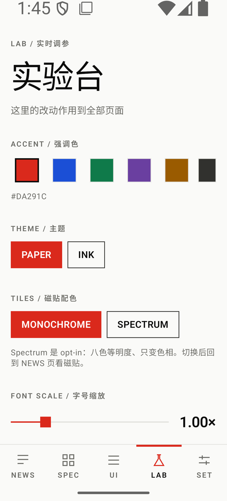

# OpenMetroUI


融合 Metro 动态磁贴与瑞士国际主义排版的 Android Compose UI 库。直角、无阴影、单一强调色、4dp 网格。

<table>
  <tr>
    <td align="center"><br/><sub>Paper · 资讯流</sub></td>
    <td align="center"><br/><sub>Ink · 深色</sub></td>
    <td align="center"><br/><sub>Lab · 实时调参</sub></td>
    <td align="center"><br/><sub>组件画廊</sub></td>
  </tr>
</table>

当前版本 0.10.10，38 个组件可用，已在真机走查。尚未发布到 Maven Central，API 仍可能调整。

## 安装

还没上 Maven Central，用 GitHub Packages 或本地仓库。

**GitHub Packages**

```kotlin
// settings.gradle.kts
repositories {
    google()
    mavenCentral()
    maven {
        url = uri("https://maven.pkg.github.com/Jeta1me1PLUS/OpenMetroUI")
        credentials {
            username = System.getenv("GITHUB_ACTOR")
            password = System.getenv("GITHUB_TOKEN")
        }
    }
}

// app/build.gradle.kts
implementation("io.github.jeta1me1plus:omui-components:0.10.10")
```

GitHub Packages 的包即使是 public，拉取也要 token（read:packages 权限）。

**本地仓库**

仓库里的 `dist/` 是一个可以直接使用的 Maven 仓库：

```bash
./gradlew publishToDist
```

```kotlin
repositories {
    maven { url = uri(rootDir.resolve("dist/maven")) }
}
```

要求 minSdk 24、Compose 1.11.4 以上。只依赖 `compose.runtime / ui / foundation / animation`，不依赖 Material3。不要和 Material3 混用，圆角、阴影、按压反馈会互相打架。

## 用法

```kotlin
setContent {
    OmTheme {
        OmScreen(scrollable = true) {
            Spacer(Modifier.height(32.dp))
            OmTopBar(
                title = "标题",
                label = "SECTION",
                onBack = { },
                actions = { OmIconButton(OmIcons.Search, "搜索") { } },
            )
            Spacer(Modifier.height(24.dp))
            OmButton("开始", onClick = { })
        }
    }
}
```

三件事需要遵守：

1. `OmTheme` 放在最外层，所有 token 从它的 CompositionLocal 读取。
2. 页边距、滚动、系统栏都交给 `OmScreen`，不要在外面再套 padding。
3. 组件参数传语义（`variant`、`tone`、`size`），传 Color 或 TextStyle 会绕过规范。

## 组件

| 类别 | API |
|---|---|
| 基础 | `OmText` `OmSurface` `OmDivider` `OmIcon` |
| 按钮 | `OmButton` `OmIconButton` |
| 布局 | `OmScreen` `OmSection` `OmGrid` `Modifier.omGridSpan` |
| 导航 | `OmTopBar` `OmCollapsingTopBar` `OmPivot` `OmBottomBar` `OmRail` `OmDrawer` |
| 内容 | `OmCard` `OmList` `OmListItem` `OmTile` `OmTileGrid` `OmTag` `OmAvatar` `OmBadge` `OmTooltip` `OmEmptyState` `OmAccordion` `OmPager` `OmPagerIndicator` |
| 输入 | `OmTextField` `OmSearchField` `OmCheckbox` `OmRadio` `OmSwitch` `OmSlider` |
| 反馈 | `OmProgressBar` `OmProgressRing` `OmSkeleton` `OmSnackbar` |
| 浮层 | `OmDialog` `OmSheet` |
| 原语 | `Modifier.omClickable` `Modifier.omFocusRing` |

规格见 [03 · 组件清单](docs/03-component-inventory.md)。

磁贴的颜色由 `tone` 声明，不直接传色值。切到 Spectrum 模式时会自动换成八色相：

```kotlin
OmTileGrid(columns = 4, gutter = 8.dp) {
    OmTile("收件箱", Modifier.omGridSpan(2).aspectRatio(1f), tone = OmTileTone.Accent)
    OmTile("日历", Modifier.omGridSpan(2).aspectRatio(1f), tone = OmTileTone.Paper)
    OmTile("音乐", Modifier.omGridSpan(4).aspectRatio(2f), tone = OmTileTone.Ink, backTitle = "12 首")
}
```

尺寸由跨栏和宽高比决定。`backTitle` 非空时点击翻面。

## 主题

```kotlin
OmTheme(
    darkTheme = false,
    accent = Color(0xFF1B4FD6),
    tileMode = OmTileMode.Monochrome,
    typography = OmTypography.System,
) { ... }
```

`onAccent` 由对比度算法自动选取。传入过浅的强调色会被拉深到对最不利表面 3:1。

库不带字体。默认跟随系统，想要最佳效果需自己提供 Inter 与思源黑体。

| 项 | 值 |
|---|---|
| 间距 | 4 / 8 / 12 / 16 / 24 / 32 / 48 / 64 / 96 dp |
| 字阶 | 11 / 12 / 14 / 16 / 18 / 22 / 28 / 36 / 48 / 64 sp |
| 字重 | 300 / 400 / 600 |
| 强调色 | `#DA291C`，深色 `#FF5A4A` |
| 描边 | 1dp / 2dp / 3dp |
| 动效 | 100 / 150 / 250 / 350 / 500 ms |

完整规范见 [00 · 设计语言](docs/00-design-language.md)。

## 用之前要知道

| 约束 | 表现 |
|---|---|
| 零圆角 | 只有头像、状态点、单选、进度环是圆的 |
| 零阴影 | 没有 elevation，层级靠底色明度和字号 |
| 单一强调色 | 状态色只能小面积使用 |
| 4dp 网格 | 所有尺寸是 4 的倍数 |
| 动效白名单 | 只有位移、淡入、色块揭示、磁贴翻转、颜色过渡 |
| 不写死高度 | 带文字的组件高度由内容决定 |

需要圆角卡片、悬浮按钮、水波纹、渐变的话，这个库不提供。

## 配色校验

换掉强调色后可以跑一遍：

```kotlin
@Test
fun `配色符合规范`() {
    OmCheck.requireContrast(OmColorScheme.paper())
    OmCheck.requireContrast(OmColorScheme.ink())
    OmCheck.requireTypography(OmTypography.System)
    OmCheck.requireSpacing(OmSpacing.Default)
}
```

检查对比度、4dp 网格、触摸目标、字阶行高、间距档位。

## Demo 与文档

`sample/` 是五页应用：资讯流、规范、组件画廊、Lab 调参台、设置。Lab 里可以实时改 accent、主题、字号，并叠加 4dp 网格看对齐。

```bash
./build.sh            # 单测 + 编译 + 归档
./build.sh --install  # 装到设备
```

| 文档 | 内容 |
|---|---|
| [00 · 设计语言](docs/00-design-language.md) | 网格、排版、颜色、形状、动效、交互、无障碍 |
| [01 · 需求与决策](docs/01-requirements.md) | 立项结论、被否选项、每处实现偏离 |
| [02 · 工程架构](docs/02-architecture.md) | 模块划分、Token 层、API 原则 |
| [03 · 组件清单](docs/03-component-inventory.md) | 38 个组件的规格与验收标准 |
| [04 · 进度与版本](docs/04-progress.md) | 版本历史、真机验证结果、待办 |
| [05 · 发布指南](docs/05-releasing.md) | 本地 / GitHub Packages / Maven Central |
| [CHANGELOG](CHANGELOG.md) | 变更流水 |

## 已知限制

- `OmTag` 的删除按钮命中区 28dp，低于 48dp 常规下限
- `OmSheet` 只能拖顶部手柄展开，不能从内容区上滑
- `OmCard` 的 Ink 变体只换底色，文字颜色要自己处理
- RTL 与 TalkBack 未做系统走查

## License

Apache License 2.0
