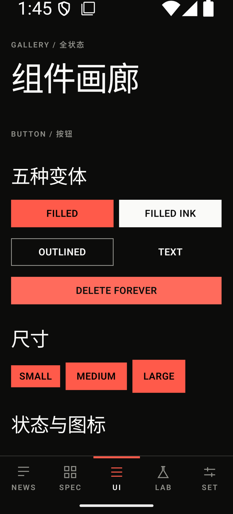

# OpenMetroUI


融合 Metro 动态磁贴与瑞士国际主义排版的 Android Compose UI 库。直角、无阴影、单一强调色、4dp 网格。

<table>
  <tr>
    <td align="center"><br/><sub>Paper · 资讯流</sub></td>
    <td align="center"><br/><sub>Ink · 深色</sub></td>
    <td align="center"><br/><sub>Lab · 实时调参</sub></td>
    <td align="center"><br/><sub>组件画廊</sub></td>
  </tr>
</table>

当前版本 0.10.10，38 个组件可用，已在真机走查。尚未发布到 Maven Central。

## 设计思路

Metro 和瑞士国际主义是两条独立的源流，但底子是同一套：扁平、无衬线、网格、靠字号建立层级、拒绝装饰。差别只在表达方式。Metro 用高饱和色块和动效说"这里能点"，瑞士用留白和极端的字号跨度说"这里重要"。

这个库让两者分工：**结构交给瑞士，色块和触感交给 Metro。**

具体落到四条硬约束上：

| 约束 | 为什么 |
|---|---|
| 圆角恒为 0 | 两派都是直角。圆角会削弱块面的几何稳定性，也让层级变得模糊 |
| 没有阴影 | 层级只由底色明度和字号建立。投影、渐变、模糊一律不用 |
| 只有一个强调色 | 保留 Metro 的色块节奏，但色块必须在瑞士的色彩纪律里活动 |
| 动效白名单 | 只允许位移、淡入、色块揭示、磁贴翻转、颜色过渡。没有弹簧和回弹 |

排版不做等比模数。UI 段用约 1.2 的压缩阶梯，展示段直接跳到 1.33 倍。层级靠跨度拉开，不靠均匀梯度。所有行高都是 4sp 的整数倍，保证多列并排时基线对齐。

多色磁贴是 opt-in 的。八色在 OKLCH 里固定明度和彩度，只变色相，所以看起来有色彩但不花。默认仍是单色相。

## 安装

还没上 Maven Central，用 GitHub Packages 或本地仓库。

**GitHub Packages**

```kotlin
// settings.gradle.kts
repositories {
    google()
    mavenCentral()
    maven {
        url = uri("https://maven.pkg.github.com/Jeta1me1PLUS/OpenMetroUI")
        credentials {
            username = System.getenv("GITHUB_ACTOR")
            password = System.getenv("GITHUB_TOKEN")
        }
    }
}

// app/build.gradle.kts
implementation("io.github.jeta1me1plus:omui-components:0.10.10")
```

包是 public，但 GitHub Packages 拉取仍然要 token（`read:packages` 权限）。

**本地仓库**

运行下面的命令，会在项目根目录生成 `dist/`，它是一个可以直接拷走的 Maven 仓库：

```bash
./gradlew publishToDist
```

```kotlin
repositories {
    maven { url = uri(rootDir.resolve("dist/maven")) }
}
```

要求 minSdk 24、Compose 1.11.4 以上。只依赖 `compose.runtime / ui / foundation / animation`，不带 Material3。不要和 Material3 混用，圆角、阴影、按压反馈会互相打架。

## 快速开始

```kotlin
setContent {
    OmTheme {
        OmScreen(scrollable = true) {
            Spacer(Modifier.height(32.dp))
            OmTopBar(
                title = "标题",
                label = "SECTION",
                onBack = { },
                actions = { OmIconButton(OmIcons.Search, "搜索") { } },
            )
            Spacer(Modifier.height(24.dp))
            OmButton("开始", onClick = { })
        }
    }
}
```

三件事需要遵守：

1. `OmTheme` 放在最外层，所有 token 从它的 CompositionLocal 读取。
2. 页边距、滚动、系统栏都交给 `OmScreen`，不要在外面再套 padding。
3. 组件参数传语义（`variant`、`tone`、`size`），传 Color 或 TextStyle 会绕过规范。

## 组件用法

### 文本与基础

```kotlin
OmText("正文", style = OmTheme.typography.bodyL)
OmText("次要信息", style = OmTheme.typography.caption, color = OmTheme.colors.textSecondary)

OmDivider()                                  // 1dp 分隔线
OmDivider(strong = true, insetStart = 16.dp)  // 2dp 结构线，左侧缩进

OmIcon(OmIcons.Check, contentDescription = "完成", size = 24.dp)

OmSurface(color = OmTheme.colors.surfaceVariant) {
    OmText("带底色的区域")
}
```

`OmText` 只接受字阶 token，不接受任意 `TextStyle` 构造。`OmIcon` 的 tint 默认跟随 `textPrimary`。

### 按钮

```kotlin
OmButton("保存", onClick = { })                                          // accent 填充
OmButton("取消", onClick = { }, variant = OmButtonVariant.Outlined)
OmButton("次要", onClick = { }, variant = OmButtonVariant.FilledInk)     // 反白块
OmButton("文字", onClick = { }, variant = OmButtonVariant.Text)
OmButton("删除", onClick = { }, variant = OmButtonVariant.Destructive)
OmButton("提交", onClick = { }, size = OmButtonSize.Large, fillWidth = true)
OmButton("继续", onClick = { }, leadingIcon = OmIcons.ArrowForward)

OmIconButton(OmIcons.Search, "搜索") { }
OmIconButton(OmIcons.Close, "删除", onClick = { }, tint = OmTheme.colors.danger)
```

视觉高度 32 / 40 / 48dp，触摸区统一 48dp。按压是底色明度下沉，不是水波纹。

### 布局

```kotlin
OmScreen(scrollable = true) {
    OmSection(label = "TODAY / 今日", title = "大标题") {
        OmText("区块内容")
    }
}

// 栏网格，子项按跨栏定位
OmGrid(columns = 4, gutter = 8.dp) {
    OmCard(Modifier.omGridSpan(2)) { OmText("占两栏") }
    OmCard(Modifier.omGridSpan(4)) { OmText("整行") }
    OmCard(Modifier.omGridSpan(2, offset = 2)) { OmText("从第 3 栏开始") }
}
```

`OmScreen` 负责页边距、正文最大宽度、系统栏内边距和整页滚动。骨架外层已经处理过 insets 时传 `applyInsets = false`。

### 导航

```kotlin
// 页头
OmTopBar(title = "设置", large = false, onBack = { })
OmTopBar(
    title = "晨间简报",
    label = "TODAY",
    actions = {
        OmIconButton(OmIcons.Search, "搜索") { }
        OmIconButton(OmIcons.MoreVert, "更多") { }
    },
)

// 随滚动收缩的页头，需要把同一个 scrollState 交给滚动内容
val scrollState = rememberScrollState()
OmCollapsingTopBar(title = "晨间简报", scrollState = scrollState)

// 横向页签
OmPivot(
    tabs = listOf("全部", "科技", "设计"),
    selectedIndex = tab,
    onSelect = { tab = it },
)

// 底部导航，3 到 5 项
OmBottomBar(
    items = listOf(
        OmBottomBarItem("NEWS", OmIcons.Article),
        OmBottomBarItem("LAB", OmIcons.Beaker),
    ),
    selectedIndex = page,
    onSelect = { page = it },
)

// 大屏侧边导航
OmRail(items = items, selectedIndex = page, onSelect = { page = it })

// 抽屉
OmDrawer(visible = open, onDismiss = { open = false }) {
    OmListItem("导航项", onClick = { })
}
```

### 磁贴

```kotlin
OmTileGrid(columns = 4, gutter = 8.dp) {
    OmTile(
        title = "收件箱",
        modifier = Modifier.omGridSpan(2).aspectRatio(1f),
        label = "3 条新消息",
        tone = OmTileTone.Accent,
    )
    OmTile(
        title = "设计周报",
        modifier = Modifier.omGridSpan(2).aspectRatio(1f),
        tone = OmTileTone.Paper,
        backTitle = "本周 8 篇，已读 3 篇",
    )
    OmTile(
        title = "阅读清单",
        modifier = Modifier.omGridSpan(4).aspectRatio(2f),
        tone = OmTileTone.Ink,
        onClick = { },
    )
}
```

颜色由 `tone` 声明，不传色值。切到 Spectrum 模式时四个 tone 会自动映射到八色相。尺寸由跨栏和宽高比决定，组件不自己算。`backTitle` 非空时点击翻面，背面必须是信息而不是动画。

### 列表与卡片

```kotlin
OmCard(variant = OmCardVariant.Flat) {
    OmText("卡片标题", style = OmTheme.typography.title)
    OmText("内容")
}

OmList(
    items = listOf("第一项", "第二项", "第三项"),
    insetStart = 16.dp,
) { item ->
    OmListItem(
        title = item,
        subtitle = "次要说明",
        trailing = { OmIcon(OmIcons.ChevronEnd, null) },
        onClick = { },
    )
}

OmListItem(title = "选中项", selected = true, onClick = { })
OmListItem(title = "禁用项", enabled = false)
```

`OmList` 负责在项之间插入分隔线，最后一项不画。手工用 `Column` 组合时要自己加 `OmDivider`。

### 输入

```kotlin
OmTextField(
    value = email,
    onValueChange = { email = it },
    label = "EMAIL / 邮箱",
    placeholder = "name@example.com",
    helperText = "会发送验证链接",
    leadingIcon = OmIcons.Search,
)

OmTextField(
    value = note,
    onValueChange = { note = it },
    variant = OmTextFieldVariant.Filled,
    singleLine = false,
    minLines = 3,
)

OmTextField(value = "错误内容", onValueChange = {}, errorText = "格式不正确")

OmSearchField(value = query, onValueChange = { query = it })

OmCheckbox(checked = agree, onCheckedChange = { agree = it }, label = "同意条款")
OmRadio(selected = choice == 1, onClick = { choice = 1 }, label = "选项一")
OmSwitch(checked = notify, onCheckedChange = { notify = it })
OmSlider(value = level, onValueChange = { level = it })
```

标签固定在输入区上方，不做浮动动画。聚焦时底线从 1dp 变 2dp 并转 accent，槽位固定所以布局不抖。

### 反馈

```kotlin
OmProgressBar(progress = 0.6f)
OmProgressBar(progress = null)                        // 硬边扫描，非渐变拖尾

OmProgressRing(progress = 0.6f)
OmProgressRing(progress = null, size = 32.dp, strokeWidth = 3.dp)

OmSkeleton(Modifier.fillMaxWidth().height(20.dp))     // 明度呼吸

OmTag("标签")
OmTag("已选", selected = true, onClick = { })
OmTag("可删除", onRemove = { })

OmBadge(text = "3")
OmBadge()                                             // 未读点
OmAvatar("Ava", size = 40.dp)

OmTooltip("提示文案")

OmAccordion(title = "折叠面板", subtitle = "副标题") {
    OmText("展开后的内容")
}

OmEmptyState(
    title = "还没有内容",
    description = "新建一条就可以开始。",
) {
    OmButton("新建", onClick = { })
}
```

### 浮层

```kotlin
OmDialog(
    visible = showDialog,
    onDismiss = { showDialog = false },
    title = "删除这条记录？",
    actions = {
        OmButton("取消", { showDialog = false }, variant = OmButtonVariant.Text)
        OmButton("删除", { showDialog = false }, variant = OmButtonVariant.Destructive)
    },
) {
    OmText("删除后无法恢复。")
}

OmSheet(visible = showSheet, onDismiss = { showSheet = false }) {
    OmText("面板内容")
}

OmSnackbar(
    visible = showSnackbar,
    message = "已保存到本地",
    actionLabel = "撤销",
    onAction = { showSnackbar = false },
)
```

`OmSheet` 的拖拽只挂在顶部 48dp 手柄区，内容区留给自己的滚动，不会误关面板。

### 轮播

```kotlin
val pagerState = rememberPagerState(pageCount = { 3 })

OmPager(
    pageCount = 3,
    state = pagerState,
    modifier = Modifier.height(160.dp),
) { page ->
    Box(Modifier.fillMaxSize().background(OmTheme.colors.surfaceVariant)) {
        OmText("第 ${page + 1} 页")
    }
}

OmPagerIndicator(pageCount = 3, currentPage = pagerState.currentPage)
```

## 主题

```kotlin
OmTheme(
    darkTheme = false,
    accent = Color(0xFF1B4FD6),
    tileMode = OmTileMode.Monochrome,
    typography = OmTypography.System,
) { ... }
```

`onAccent` 由对比度算法自动选取。传入过浅的强调色会被拉深到对最不利表面 3:1。库不带字体，默认跟随系统，想要最佳效果需自己提供 Inter 与思源黑体：

```kotlin
OmTheme(typography = OmTypography.System.withFontFamily(myFontFamily)) { ... }
```

| 项 | 值 |
|---|---|
| 间距 | 4 / 8 / 12 / 16 / 24 / 32 / 48 / 64 / 96 dp |
| 字阶 | 11 / 12 / 14 / 16 / 18 / 22 / 28 / 36 / 48 / 64 sp |
| 字重 | 300 / 400 / 600 |
| 强调色 | `#DA291C`，深色 `#FF5A4A` |
| 描边 | 1dp 结构线 / 2dp 聚焦与选中 / 3dp Pivot 指示条 |
| 动效 | 100 / 150 / 250 / 350 / 500 ms |
| 触摸目标 | 48dp，标签内次级操作是唯一例外 |

## 用之前要知道

| 约束 | 表现 |
|---|---|
| 零圆角 | 只有头像、状态点、单选、进度环是圆的 |
| 零阴影 | 没有 elevation，层级靠底色明度和字号 |
| 单一强调色 | 状态色只能小面积使用 |
| 4dp 网格 | 所有尺寸是 4 的倍数 |
| 不写死高度 | 带文字的组件高度由内容决定，大字号下不裁切 |

需要圆角卡片、悬浮按钮、水波纹、渐变背景的话，这个库不提供。

## 配色校验

换掉强调色后跑一遍，确认配色还站得住：

```kotlin
@Test
fun `配色符合规范`() {
    OmCheck.requireContrast(OmColorScheme.paper())
    OmCheck.requireContrast(OmColorScheme.ink())
    OmCheck.requireTypography(OmTypography.System)
    OmCheck.requireSpacing(OmSpacing.Default)
    OmCheck.requireOnGrid(listOf(16.dp, 24.dp))
}
```

覆盖对比度（含全部磁贴色对）、4dp 网格、触摸目标、字阶行高、间距档位。

## Demo

`sample/` 是五页应用：资讯流、规范、组件画廊、Lab 调参台、设置。Lab 里可以实时改 accent、主题、字号缩放，并叠加 4dp 网格看对齐。

```bash
./build.sh            # 单测 + 编译 + 归档
./build.sh --install  # 装到设备并启动
```

## 工程结构

```text
omui-core/         token、主题、交互原语、栅格布局
omui-components/   38 个组件
omui-icons/        13 个几何图标
omui-test/         OmCheck 设计约束校验（只在测试配置里用）
sample/            五页 demo
smoke/             发布产物接入验证（只用 Maven 坐标）
```

`dist/` 是 `publishToDist` 的生成物，不进版本库。

## 已知限制

- `OmTag` 的删除按钮命中区 28dp，低于 48dp 常规下限
- `OmSheet` 只能拖顶部手柄展开，不能从内容区上滑
- `OmCard` 的 Ink 变体只换底色，文字颜色要自己处理
- RTL 与 TalkBack 未做系统走查

变更记录见 [CHANGELOG.md](CHANGELOG.md)。

## License

Apache License 2.0
