# OpenMetroUI


**English** · [简体中文](README.zh-CN.md)

A Jetpack Compose UI library that fuses **Metro tiles** with **Swiss International Typographic Style**. Square corners, no shadows, one accent color, 4dp grid.

<table>
  <tr>
    <td align="center">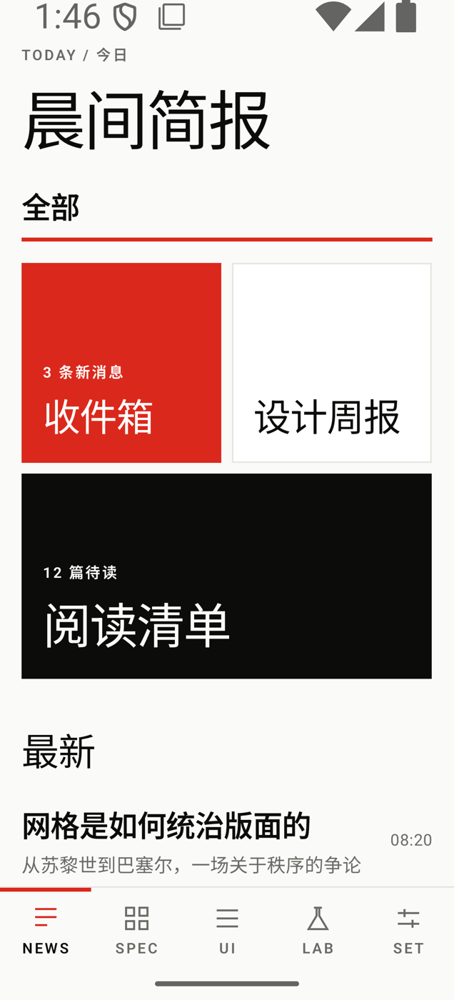<br/><sub>Paper · feed</sub></td>
    <td align="center">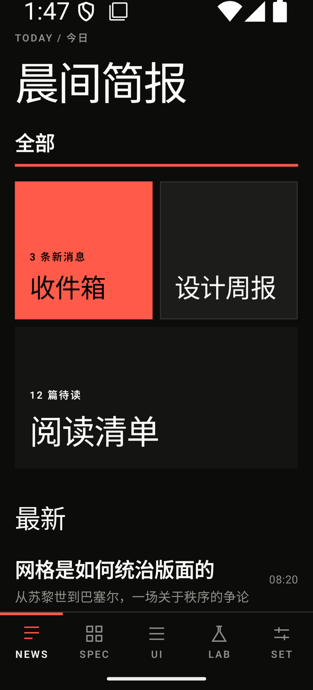<br/><sub>Ink · dark</sub></td>
    <td align="center"><br/><sub>Lab · live tokens</sub></td>
  </tr>
</table>

57 components, verified on device. Requires minSdk 24 and Compose 1.11.4+.

---

## 1. Why another UI library

Metro and Swiss Style share a foundation: flat, sans-serif, grid-driven, hierarchy by type size, no ornament. They differ in expression. Metro uses saturated blocks and motion to say *this is tappable*. Swiss uses white space and extreme type contrast to say *this matters*.

This library splits the work: **structure from Swiss, blocks and touch from Metro.**

| Constraint | Reason |
|---|---|
| Zero corner radius | Both movements are orthogonal. Rounded corners weaken the geometric stability of a block |
| No shadows | Hierarchy comes from surface luminance and type size only |
| One accent color | Keeps Metro's color rhythm inside Swiss color discipline |
| Motion whitelist | Only translation, fade, block reveal, tile flip, color transition. No springs, no bounce |

Type does not follow a geometric scale. UI sizes step by ~1.2, display sizes jump 1.33×. Hierarchy comes from the jump, not from an even gradient. Every line height is a multiple of 4sp so multi-column baselines align.

Spectrum tiles are opt-in. The eight hues share fixed lightness and chroma in OKLCH and vary only in hue, so the result is colorful but not noisy. The default remains monochrome.

---

## 2. Installation

### 2.1 Maven Central

```kotlin
implementation("io.github.jeta1me1plus:omui-components:0.17.2")
```

No extra repository config needed. Verified by resolving the published artifact with `mavenCentral()` only.

### 2.2 GitHub Packages

```kotlin
// settings.gradle.kts
repositories {
    google()
    mavenCentral()
    maven {
        url = uri("https://maven.pkg.github.com/Jeta1me1PLUS/OpenMetroUI")
        credentials {
            username = System.getenv("GITHUB_ACTOR")
            password = System.getenv("GITHUB_TOKEN")
        }
    }
}
```

The package is public, but GitHub Packages still requires a token with `read:packages`.

### 2.3 Local repository

```bash
./gradlew publishToDist
```

```kotlin
repositories {
    maven { url = uri(rootDir.resolve("dist/maven")) }
}
```

### 2.4 Requirements

| Item | Value |
|---|---|
| minSdk | 24 |
| Compose | 1.11.4+ |
| Dependencies | `compose.runtime / ui / foundation / animation` only |
| Not included | Material3, Material Icons, DI frameworks, annotation processors |

**Do not mix with Material3.** Corner radius, elevation, ripple feedback and color semantics will fight each other.

---

## 3. Quick start

```kotlin
setContent {
    OmTheme {
        OmScreen(scrollable = true) {
            Spacer(Modifier.height(32.dp))
            OmTopBar(
                title = "Morning Brief",
                label = "TODAY",
                onBack = { },
                actions = { OmIconButton(OmIcons.Search, "Search") { } },
            )
            Spacer(Modifier.height(24.dp))
            OmButton("Start", onClick = { })
        }
    }
}
```

Three rules:

1. `OmTheme` must be the outermost composable. Every token is read from its CompositionLocals.
2. Page margins, scrolling and system bars belong to `OmScreen`. Don't wrap it in your own padding.
3. Pass semantic parameters (`variant`, `tone`, `size`). Passing raw `Color` or `TextStyle` bypasses the spec.

---

## 4. Components

| Category | APIs |
|---|---|
| Foundation | `OmText` `OmSurface` `OmDivider` `OmIcon` |
| Buttons | `OmButton` `OmIconButton` |
| Layout | `OmScreen` `OmSection` `OmGrid` `Modifier.omGridSpan` |
| Navigation | `OmTopBar` `OmCollapsingTopBar` `OmPivot` `OmBottomBar` `OmRail` `OmDrawer` |
| Tiles | `OmTile` `OmTileGrid` |
| Content | `OmCard` `OmList` `OmListItem` `OmListSection` `OmTag` `OmAvatar` `OmBadge` `OmTooltip` `OmEmptyState` `OmErrorState` `OmAccordion` `OmPager` `OmPagerIndicator` `OmStat` `OmSparkline` `OmTable` `OmTimeline` `OmSwipeToDismiss` |
| Inputs | `OmTextField` `OmSearchField` `OmCheckbox` `OmRadio` `OmSwitch` `OmSlider` `OmSegmentedControl` `OmStepperInput` `OmDropdown` `OmDatePicker` `OmOtpInput` `OmChipInput` |
| Feedback | `OmProgressBar` `OmProgressRing` `OmSkeleton` `OmSnackbar` `OmBanner` |
| Overlays | `OmDialog` `OmSheet` `OmSideSheet` `OmMenu` |
| Primitives | `Modifier.omClickable` `Modifier.omFocusRing` |

### 4.1 Buttons

Five variants, three sizes, 48dp touch target regardless of visual height. Pressing darkens the surface by 8% — there is no ripple.

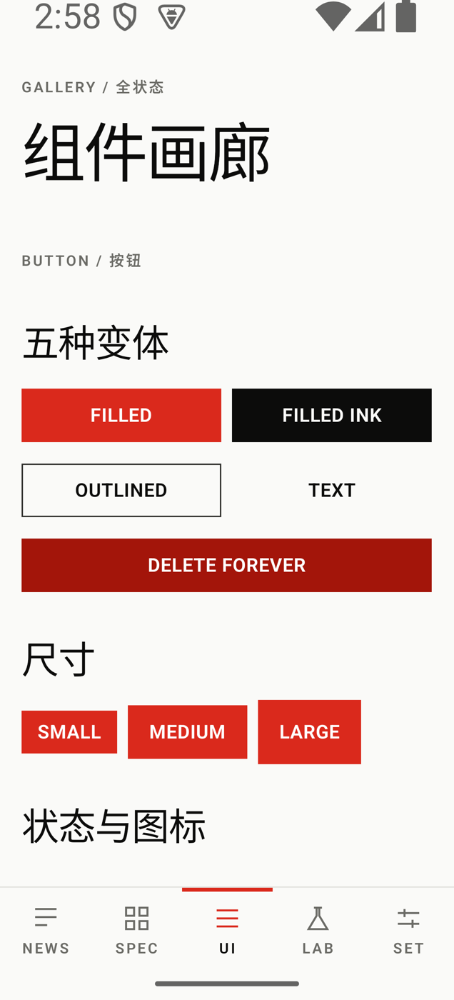

```kotlin
OmButton("Save", onClick = { })                                        // accent fill
OmButton("Cancel", onClick = { }, variant = OmButtonVariant.Outlined)
OmButton("Secondary", onClick = { }, variant = OmButtonVariant.FilledInk)
OmButton("Plain", onClick = { }, variant = OmButtonVariant.Text)
OmButton("Delete", onClick = { }, variant = OmButtonVariant.Destructive)
OmButton("Submit", onClick = { }, size = OmButtonSize.Large, fillWidth = true)
OmButton("Next", onClick = { }, leadingIcon = OmIcons.ArrowForward)

OmIconButton(OmIcons.Search, "Search") { }
OmIconButton(OmIcons.Close, "Delete", onClick = { }, tint = OmTheme.colors.danger)
```

### 4.2 Inputs

Labels sit above the field and never float. The underline slot is always 2dp, so switching from 1dp to 2dp on focus does not shift layout.

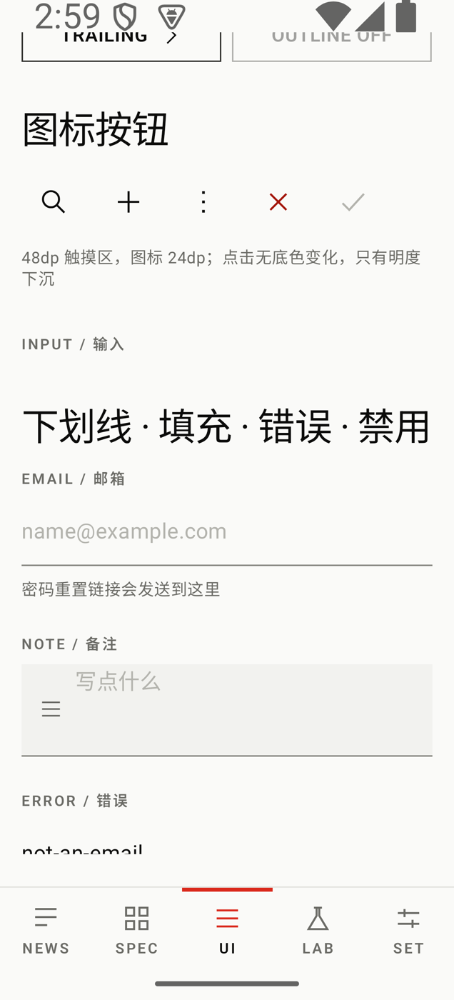

```kotlin
OmTextField(
    value = email,
    onValueChange = { email = it },
    label = "EMAIL",
    placeholder = "name@example.com",
    helperText = "A reset link will be sent here",
    leadingIcon = OmIcons.Search,
)

OmTextField(
    value = note,
    onValueChange = { note = it },
    variant = OmTextFieldVariant.Filled,
    singleLine = false,
    minLines = 3,
)

OmTextField(value = value, onValueChange = {}, errorText = "Invalid format")
OmSearchField(value = query, onValueChange = { query = it })
```

### 4.3 Lists and cards

`OmList` inserts hairlines between items and skips the last one. Selection is a 3dp accent bar drawn behind the row, so it never shifts the text.

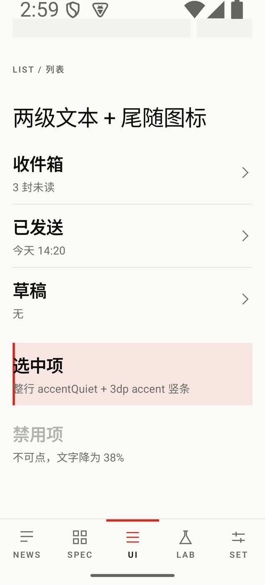
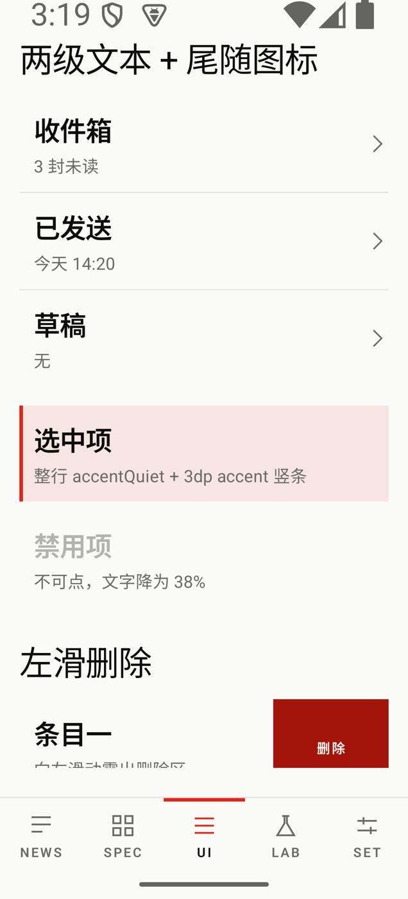
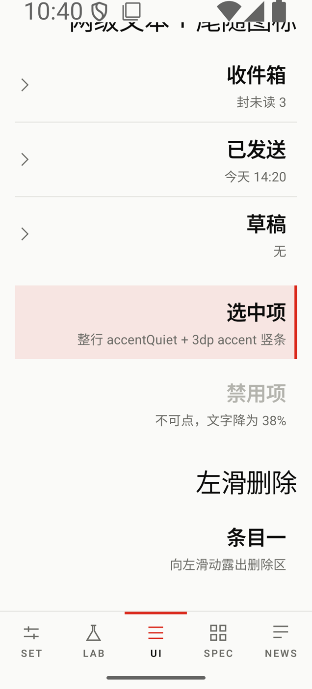
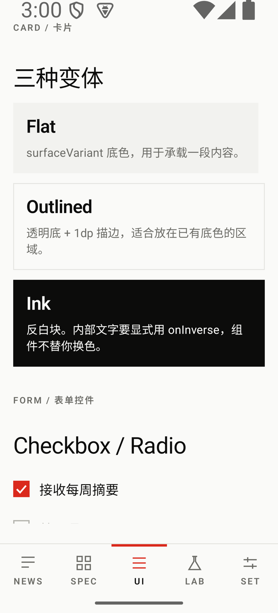
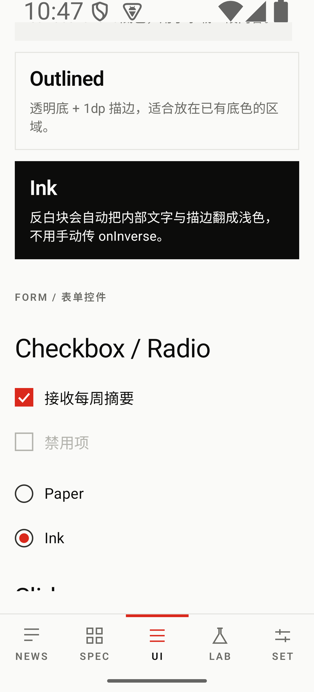

```kotlin
OmList(items = rows, insetStart = 16.dp) { row ->
    OmListItem(
        title = row.title,
        subtitle = row.subtitle,
        trailing = { OmIcon(OmIcons.ChevronEnd, null) },
        onClick = { },
    )
}

OmListItem(title = "Selected", selected = true, onClick = { })

OmCard(variant = OmCardVariant.Outlined) {
    OmText("Card title", style = OmTheme.typography.title)
    OmText("Body copy")
}
```

The `Ink` variant inverts the inner text and stroke colors automatically, so `OmText` inside it stays readable without passing `onInverse`.

### 4.4 Tiles

Tiles never take a color directly, only a `tone`. Switching to Spectrum remaps all tones to the eight-hue palette without touching call sites. Size comes from grid span and aspect ratio — the component does not compute its own size.

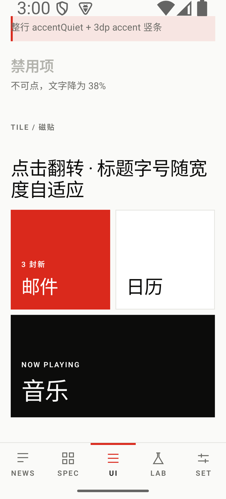

```kotlin
OmTileGrid(columns = 4, gutter = 8.dp) {
    OmTile(
        title = "Inbox",
        modifier = Modifier.omGridSpan(2).aspectRatio(1f),
        label = "3 new",
        tone = OmTileTone.Accent,
    )
    OmTile(
        title = "Weekly",
        modifier = Modifier.omGridSpan(2).aspectRatio(1f),
        tone = OmTileTone.Paper,
        backTitle = "8 posts, 3 read",
    )
    OmTile(
        title = "Reading list",
        modifier = Modifier.omGridSpan(4).aspectRatio(2f),
        tone = OmTileTone.Ink,
        onClick = { },
    )
}
```

A non-null `backTitle` enables a Y-axis flip on tap. The back face must carry information, not just an animation.

Pass `rotatingTitles` to turn it into a Live Tile: the front title cycles every 8 seconds by default, independent of the flip.

### 4.5 Forms

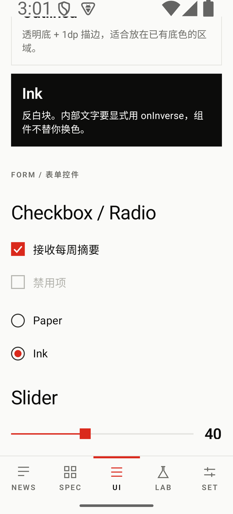

```kotlin
OmCheckbox(checked = agree, onCheckedChange = { agree = it }, label = "Weekly digest")
OmRadio(selected = choice == 1, onClick = { choice = 1 }, label = "Option one")
OmSwitch(checked = notify, onCheckedChange = { notify = it })
OmSlider(value = level, onValueChange = { level = it })
```

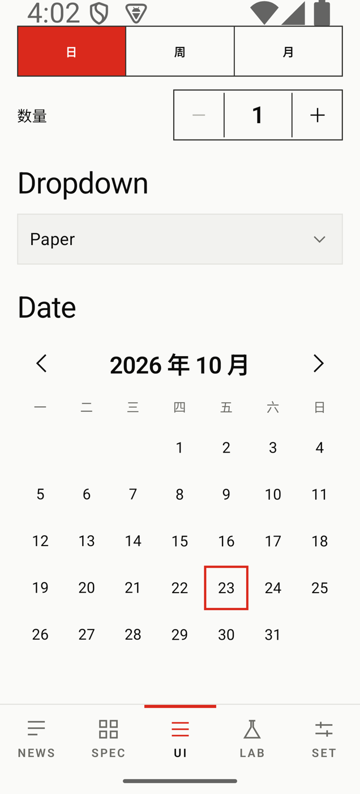
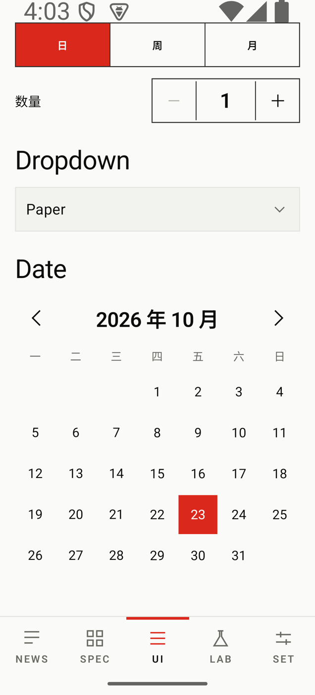

```kotlin
OmSegmentedControl(
    options = listOf("Day", "Week", "Month"),
    selectedIndex = segment,
    onSelect = { segment = it },
)

OmStepperInput(value = count, onValueChange = { count = it }, min = 1, max = 9)

OmDropdown(
    options = listOf("Paper", "Ink", "Spectrum"),
    selectedIndex = choice,
    onSelect = { choice = it },
)

OmDatePicker(selected = date, onSelect = { date = it })
```

### 4.6 Feedback

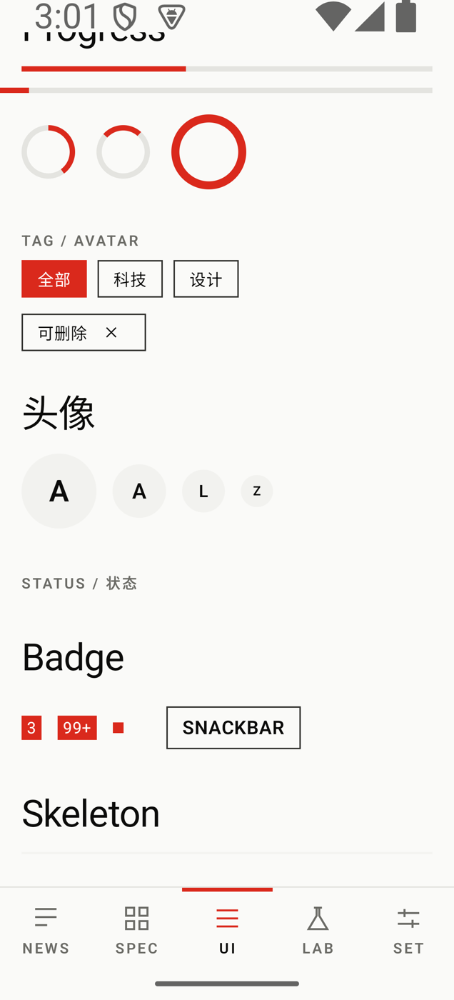

```kotlin
OmProgressBar(progress = 0.6f)
OmProgressBar(progress = null)                        // hard-edge scan, no gradient trail
OmProgressRing(progress = 0.6f)
OmProgressRing(progress = null, size = 32.dp)

OmSkeleton(Modifier.fillMaxWidth().height(20.dp))     // luminance breathing

OmTag("Tag")
OmTag("Selected", selected = true, onClick = { })
OmTag("Removable", onRemove = { })

OmBadge(text = "3")
OmAvatar("Ava", size = 40.dp)
OmTooltip("Hint text")

OmEmptyState(title = "Nothing here", description = "Create one to start.") {
    OmButton("New", onClick = { })
}

OmAccordion(title = "Section", subtitle = "Subtitle") {
    OmText("Expanded content")
}
```

### 4.7 Navigation

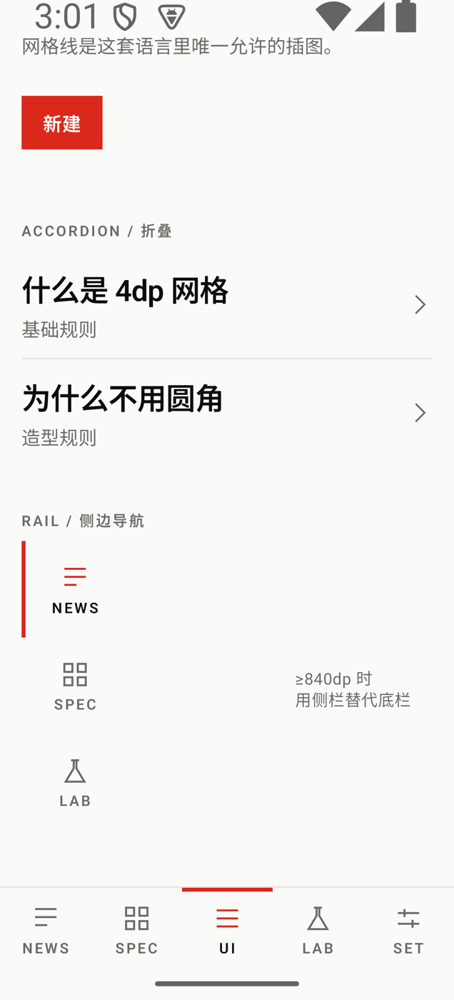

```kotlin
OmTopBar(title = "Settings", large = false, onBack = { })
OmCollapsingTopBar(title = "Feed", scrollState = scrollState)   // 48sp -> 22sp on scroll

OmPivot(
    tabs = listOf("All", "Tech", "Design"),
    selectedIndex = tab,
    onSelect = { tab = it },
    pagerState = pagerState,   // optional: syncs taps and swipes both ways
)

OmBottomBar(
    items = listOf(
        OmBottomBarItem("NEWS", OmIcons.Article),
        OmBottomBarItem("LAB", OmIcons.Beaker),
    ),
    selectedIndex = page,
    onSelect = { page = it },
)

OmRail(items = items, selectedIndex = page, onSelect = { page = it })   // >= 840dp
OmDrawer(visible = open, onDismiss = { open = false }) { /* nav items */ }
```

### 4.8 Overlays

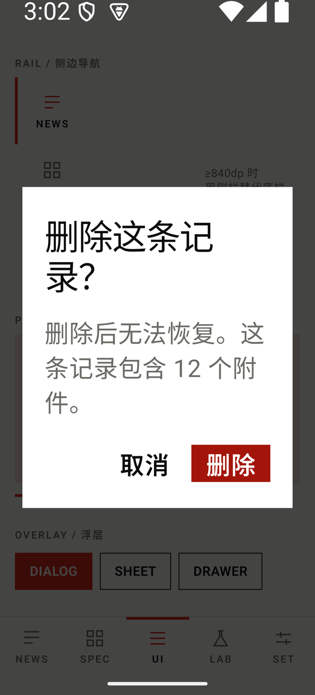

```kotlin
OmDialog(
    visible = showDialog,
    onDismiss = { showDialog = false },
    title = "Delete this record?",
    actions = {
        OmButton("Cancel", { showDialog = false }, variant = OmButtonVariant.Text)
        OmButton("Delete", { showDialog = false }, variant = OmButtonVariant.Destructive)
    },
) {
    OmText("This cannot be undone.")
}

OmSheet(visible = showSheet, onDismiss = { showSheet = false }) { /* content */ }

OmSnackbar(
    visible = showSnackbar,
    message = "Saved locally",
    actionLabel = "Undo",
    onAction = { showSnackbar = false },
)
```

`OmSheet` drags from its 48dp handle only by default, leaving the content area free for its own scroll. Pass `dragHandleOnly = false` when the content does not scroll.


### 4.9 Data

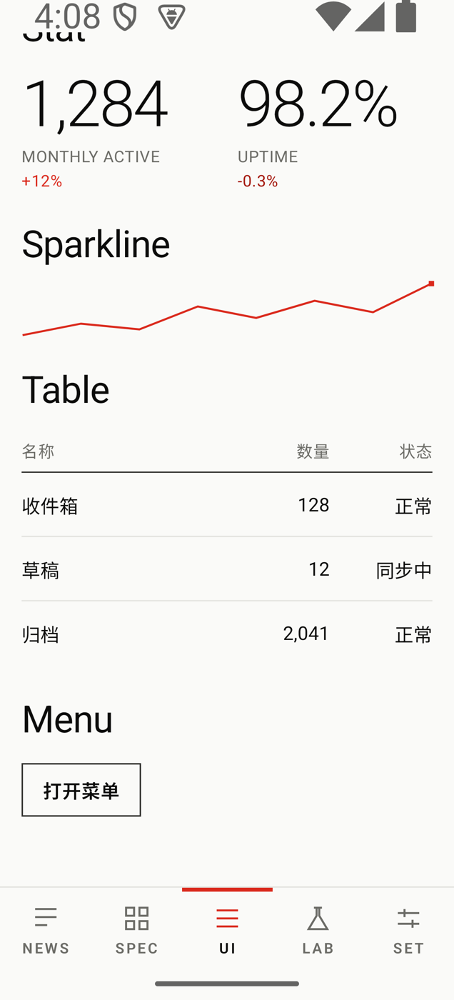
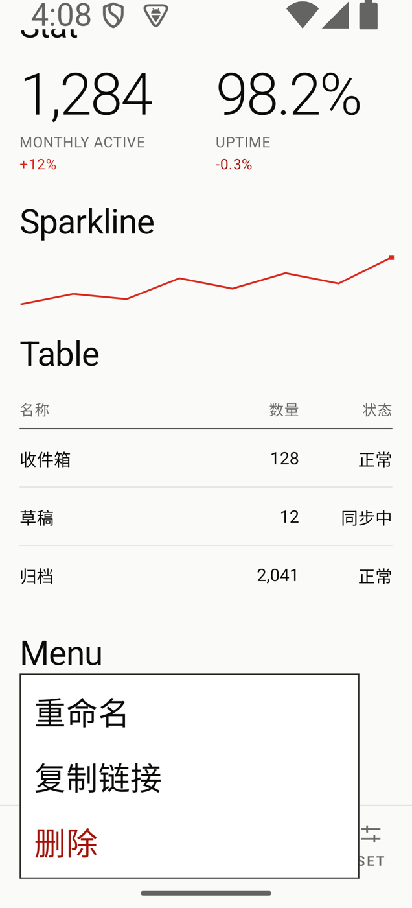
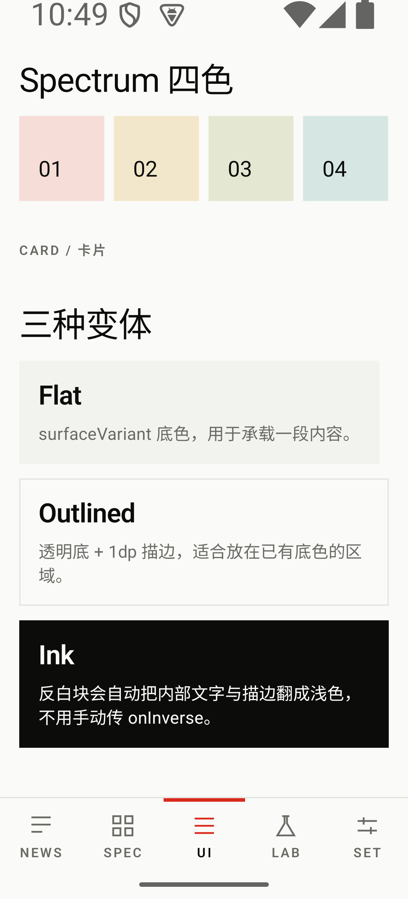

```kotlin
OmStat(value = "1,284", label = "MONTHLY ACTIVE", delta = "+12%")
OmStat(value = "98.2%", label = "UPTIME", delta = "-0.3%", deltaPositive = false)

OmSparkline(values = listOf(3f, 5f, 4f, 8f, 6f, 9f, 7f, 12f))

OmTable(
    columns = listOf(
        OmTableColumn("Name", weight = 2f),
        OmTableColumn("Count", weight = 1f, align = OmColumnAlign.End),
    ),
    rows = listOf(listOf("Inbox", "128"), listOf("Drafts", "12")),
    onRowClick = { },
)

OmMenu(
    expanded = open,
    onDismissRequest = { open = false },
    offset = IntOffset(0, 48.dp.roundToPx()),
) {
    OmMenuItem("Rename", onClick = { open = false })
    OmMenuItem("Delete", onClick = { open = false }, destructive = true)
}
```

Menus and dropdowns flip to the other side automatically when there is not enough room below, so a trigger near the bottom of the screen still shows the full panel.


### 4.10 Layout and extras

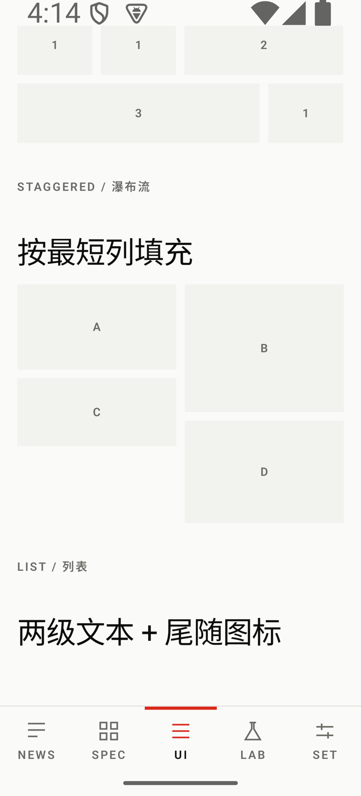
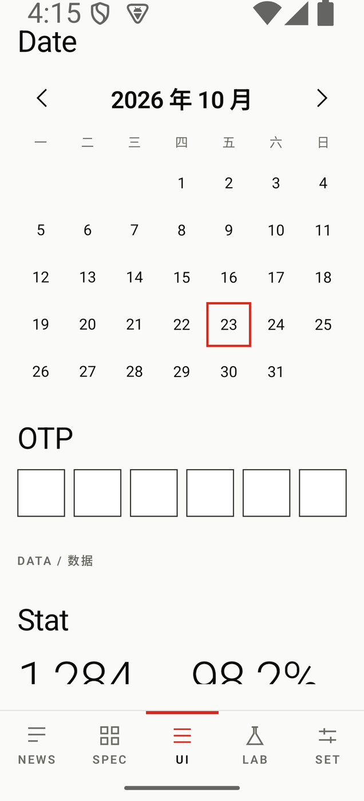
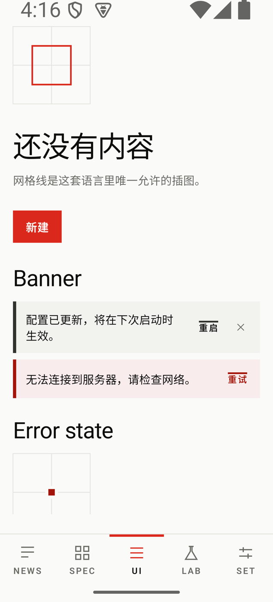
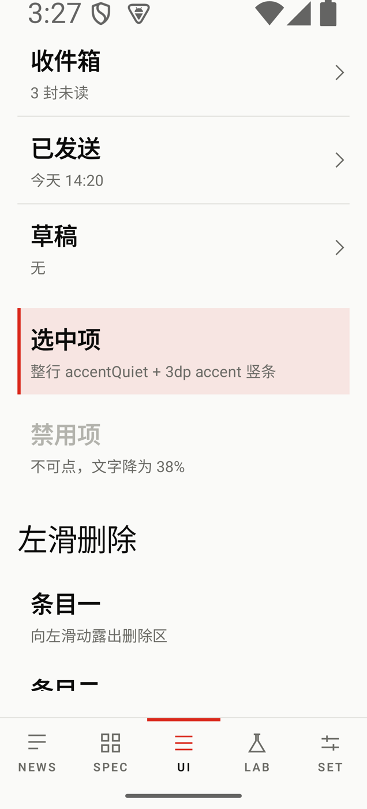
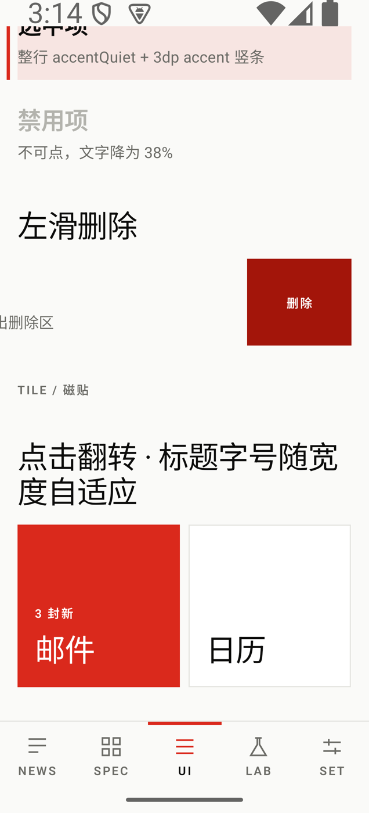

```kotlin
OmBanner(
    text = "Config updated.",
    actionLabel = "Restart",
    onAction = { },
    onDismiss = { },
)
OmBanner(text = "Cannot reach the server.", tone = OmBannerTone.Error)

OmErrorState(title = "Load failed", description = "Check your connection.") {
    OmButton("Retry", onClick = { })
}

OmOtpInput(value = code, onValueChange = { code = it }, length = 6)

OmSwipeToDismiss(onDismiss = { }) {
    OmListItem(title = "Swipe left to delete", onClick = { })
}

OmStaggeredGrid(columns = 2) {
    OmTile("A", Modifier.height(80.dp))
    OmTile("B", Modifier.height(120.dp))
}

OmResponsivePane(
    list = { /* list column */ },
    detail = { /* shown when width >= 840dp */ },
)

OmSideSheet(visible = open, onDismiss = { open = false }) { /* content */ }
```


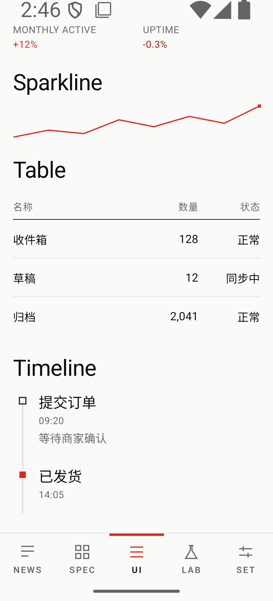
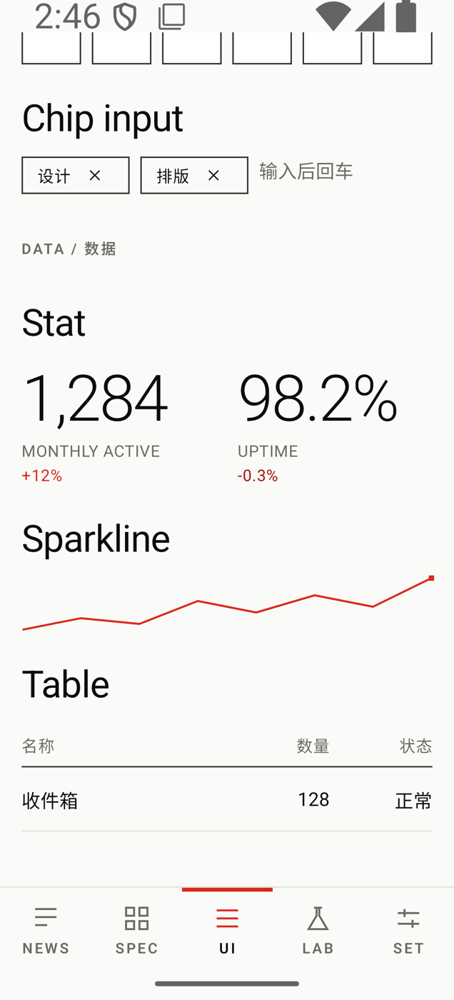

```kotlin
OmListSection("Notifications") {
    OmListItem("Push", trailing = { OmSwitch(checked = on, onCheckedChange = { }) })
    OmListItem("Email", trailing = { OmSwitch(checked = off, onCheckedChange = { }) })
}

OmTimeline(
    items = listOf(
        OmTimelineItem("Order placed", time = "09:20", description = "Waiting for confirmation"),
        OmTimelineItem("Shipped", time = "14:05", current = true),
        OmTimelineItem("Delivered", time = "Tomorrow"),
    ),
)

OmChipInput(values = tags, onValuesChange = { tags = it })
```

---

## 5. Theming

```kotlin
OmTheme(
    darkTheme = false,
    accent = Color(0xFF1B4FD6),
    tileMode = OmTileMode.Monochrome,
    typography = OmTypography.System,
) { ... }
```

`onAccent` is chosen by a contrast algorithm. An accent that is too light gets darkened until it reaches 3:1 against the least favorable surface.

The library ships no font files. It follows the system font by default; for best results supply Inter and Noto Sans SC yourself:

```kotlin
OmTheme(typography = OmTypography.System.withFontFamily(myFontFamily)) { ... }
```

| Token | Values |
|---|---|
| Spacing | 4 / 8 / 12 / 16 / 24 / 32 / 48 / 64 / 96 dp |
| Type scale | 11 / 12 / 14 / 16 / 18 / 22 / 28 / 36 / 48 / 64 sp |
| Weights | 300 / 400 / 600 |
| Accent | `#DA291C` light, `#FF5A4A` dark |
| Strokes | 1dp structural, 2dp focus/selected, 3dp pivot indicator |
| Motion | 100 / 150 / 250 / 350 / 500 ms |

---

## 6. Constraints that shape usage

| Constraint | Effect |
|---|---|
| Zero radius | Only avatars, status dots, radios and progress rings are round |
| Zero elevation | No shadow parameter; hierarchy via luminance and type size |
| Single accent | Status colors only in small areas |
| 4dp grid | Every dimension is a multiple of 4 |
| No fixed heights | Text-bearing components size themselves; large fonts won't clip |

If you need rounded cards, FABs, ripples or gradients, this library does not provide them and will not add them.

### Accessibility

- **RTL**: every decoration drawn with `drawBehind` mirrors with `LayoutDirection`; swipe-to-dismiss becomes right-swipe. Layout mirrors automatically because it uses `start`/`end`.
- **Screen readers**: snackbars and banners announce through `liveRegion`; progress components report `progressBarRangeInfo`; swipe-to-dismiss exposes a custom accessibility action.
- **Touch targets**: 48dp minimum. `OmTag` keeps a 28dp visual but occupies 48dp.
- **Reduced motion**: `OmMotion` follows the system animator duration scale; setting it to 0 makes every animation instant.

---

## 7. Validating your colors

After swapping the accent, run the checker:

```kotlin
@Test
fun `colors conform to spec`() {
    OmCheck.requireContrast(OmColorScheme.paper())
    OmCheck.requireContrast(OmColorScheme.ink())
    OmCheck.requireTypography(OmTypography.System)
    OmCheck.requireSpacing(OmSpacing.Default)
    OmCheck.requireOnGrid(listOf(16.dp, 24.dp))
}
```

Covers contrast (including every tile pair), the 4dp grid, touch targets, type scale and line heights, and spacing steps. Must be declared as `testImplementation`.

---

## 8. Demo

`sample/` is a five-page app: feed, spec, component gallery, Lab, settings. Lab lets you change accent, theme, font scale and overlay a 4dp grid at runtime.

```bash
./build.sh              # tests + build + archive APK
./build.sh --install    # install to device
```

A prebuilt APK is attached to each [release](https://github.com/Jeta1me1PLUS/OpenMetroUI/releases).

---

## 9. Project structure

```text
omui-core/         tokens, theme, interaction primitives, grid layout
omui-components/   57 components
omui-icons/        13 geometric icons
omui-test/         OmCheck design-spec validation
sample/            five-page demo
smoke/             consumes the published artifact via Maven coordinates only
```

`dist/` is generated by `publishToDist` and is not tracked.

---

## 10. Known limitations

- `OmSheet` drags from its handle by default; pass `dragHandleOnly = false` when the content does not scroll
- RTL is supported; TalkBack has basic semantics but has not been audited with a screen reader

---

## 11. License

Apache License 2.0
